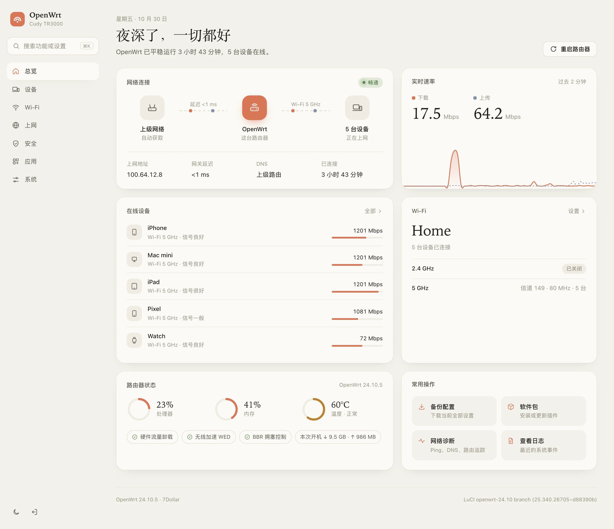
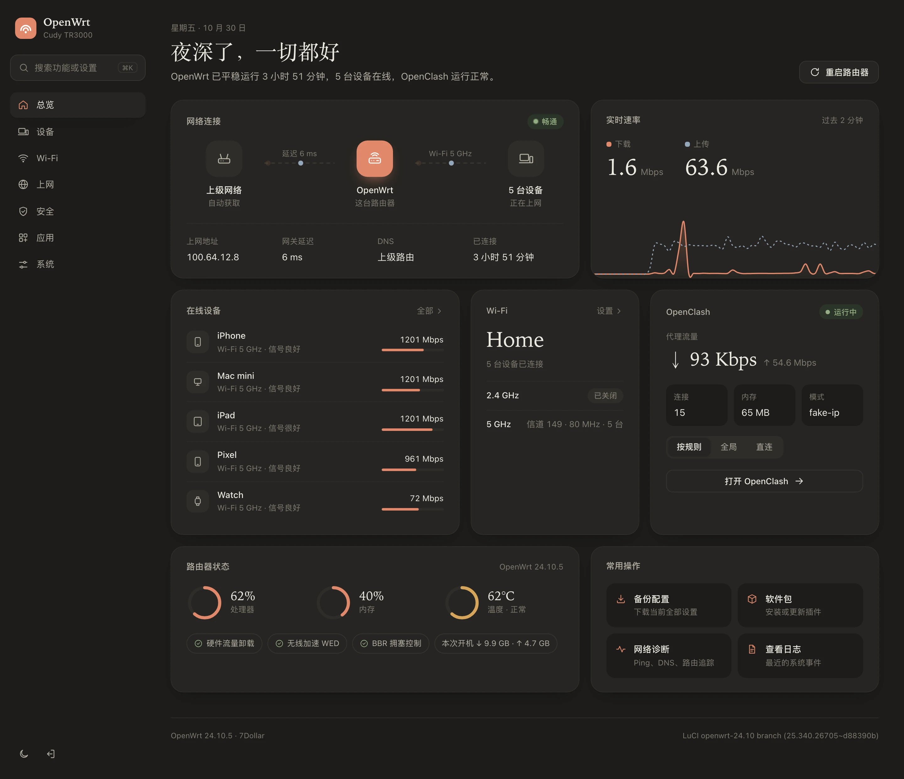
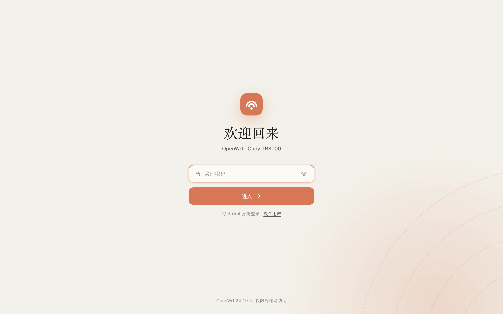
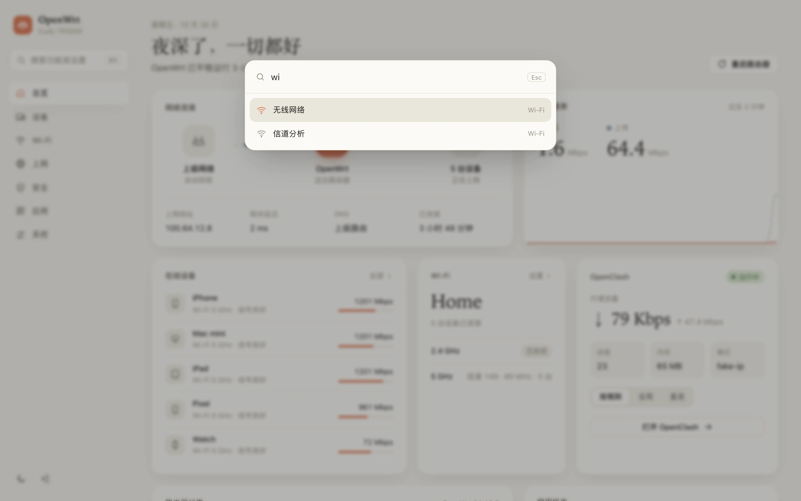
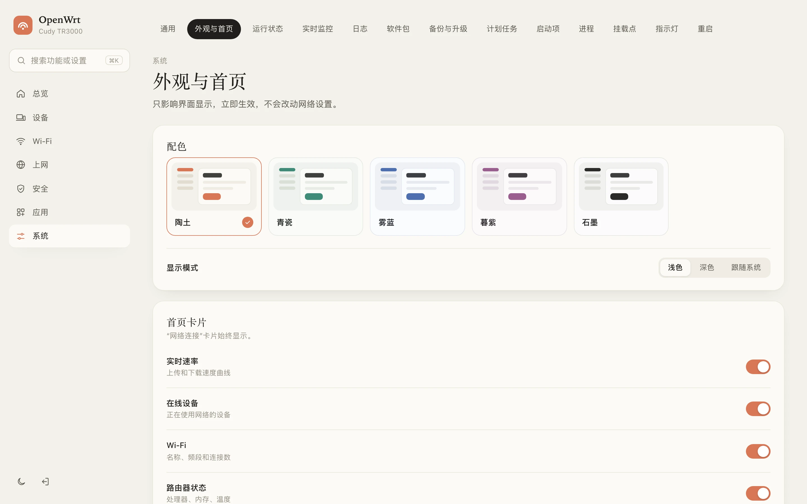
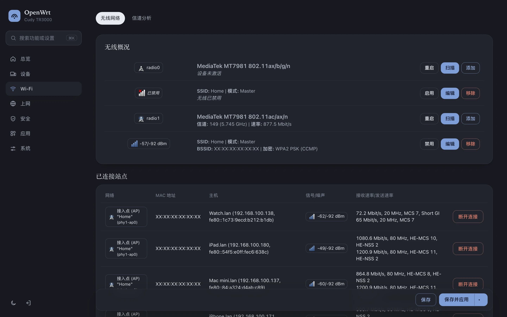

<p align="center">
  
</p>

<h1 align="center">7Dollar</h1>

<p align="center">
  不像工程师后台的 OpenWrt 主题<br>
  <sub>An OpenWrt theme that doesn't look like an engineer's console</sub>
</p>

<p align="center">
  
  
  
</p>

<p align="center">
  <a href="#安装">安装</a> · <a href="#使用">使用</a> · <a href="#卸载">卸载</a> · <a href="#english">English</a>
</p>

<p align="center">
  
</p>

## 为什么做它

OpenWrt 的大多数主题只换了颜色，页面还是满屏参数、表格和英文缩写，不懂网络的人很难看懂。7Dollar 想让任何人打开后台都能看懂。

| | 常见主题 | 7Dollar |
| --- | --- | --- |
| 首页 | 一屏参数表 | 一张图看清：网通不通、多快、谁在用 |
| 菜单 | 按技术模块分：状态 / 系统 / 服务 / 网络 | 按要做的事分：设备 / Wi‑Fi / 上网 / 安全 |
| 设备 | MAC 地址和 IP 列表 | 设备名、类型、信号好坏、连了多久 |
| 状态页 | 所有字段一次铺开 | 先看要紧的，MAC、BSSID 等点「详情」再看 |
| 用词 | 2g / 5g、DHCP 租约 | 2.4 GHz / 5 GHz、在线设备 |
| 找功能 | 一层层翻菜单 | <kbd>⌘K</kbd> 直接搜 |

原有的功能一项不少，只是换了个更容易看懂的方式呈现。

## 关于名字

开发这个主题一共花了 **7 美元** 的 AI Token 费用，所以叫 7Dollar。

## 特性

- **首页总览**：网络状态、实时速率、在线设备、Wi‑Fi、路由器状态、网口、存储空间，卡片可按需开关，自动排成两列不留空白
- **按用途分组的菜单**：总览 / 设备 / Wi‑Fi / 上网 / 安全 / 应用 / 系统，支持 <kbd>⌘K</kbd> / <kbd>Ctrl K</kbd> 搜索
- **5 套配色**：陶土、青瓷、雾蓝、暮紫、石墨，各有浅色 / 深色，可跟随系统
- **「应用」卡片可选**：默认关闭；打开后首页列出正在运行的插件，任何插件都行。常见插件多一行要紧信息（OpenClash 可切换代理模式、PassWall 当前节点、文件共享剩余空间……），只读配置，不碰插件接口
- **自适应**：手机、平板、页面缩放下都会重新排版
- **轻量**：无外部字体和请求，CSS 16 KB（gzip），安装包 48 KB
- **兼容原生页面**：LuCI 所有功能保持不变，原生图标统一换成主题风格
- **信息分层**：Wi‑Fi、接口、状态页默认只显示常用信息，MAC、BSSID、数据包数等点「详情」展开

## 截图

<p align="center"></p>

<table>
  <tr>
    <td width="50%"><p align="center"><sub>深色模式</sub></p></td>
    <td width="50%"><p align="center"><sub>手机</sub></p></td>
  </tr>
  <tr>
    <td width="50%"><p align="center"><sub>登录页</sub></p></td>
    <td width="50%"><p align="center"><sub>搜索</sub></p></td>
  </tr>
  <tr>
    <td width="50%"><p align="center"><sub>外观设置</sub></p></td>
    <td width="50%"><p align="center"><sub>原生页面</sub></p></td>
  </tr>
</table>

## 安装

先确认路由器系统是 **OpenWrt 23.05 或更新版本**（后台「状态 → 概览」里能看到版本号）。

### 方法一：网页上传（推荐，不用命令行）

适用于 23.05 / 24.10。25.x 请用方法二。

1. 下载安装包：[luci-theme-7dollar_1.0.12-r1_all.ipk](https://github.com/itsmaiGe/luci-theme-7dollar/releases/latest/download/luci-theme-7dollar_1.0.12-r1_all.ipk)（历史版本见 [Releases](https://github.com/itsmaiGe/luci-theme-7dollar/releases)）
2. 浏览器打开路由器后台（通常是 `192.168.1.1`），输入密码登录
3. 点 **系统 → 软件包 → 上传软件包…**，选择刚下载的文件，点 **上传**，再点 **安装**
4. 刷新页面（Windows 按 <kbd>F5</kbd>，Mac 按 <kbd>⌘ R</kbd>）

> 刷新后没变化：打开 **系统 → 系统 → 语言和界面**，把 **主题** 改成 **7Dollar**，点 **保存并应用**。

### 方法二：一行命令

适用于所有支持的版本，会自动选择 ipk（23.05 / 24.10）或 apk（25.x）安装包。

1. 打开终端：Mac 搜索「终端」，Windows 搜索「PowerShell」
2. 登录路由器（把 IP 换成你的路由器地址）：

   ```sh
   ssh root@192.168.1.1
   ```

   首次连接提示 `yes/no` 时输入 `yes` 回车；然后输入路由器密码回车（输入时不显示字符，属于正常现象）。

3. 粘贴下面这行并回车，看到「完成」后刷新浏览器：

   ```sh
   wget -qO- https://raw.githubusercontent.com/itsmaiGe/luci-theme-7dollar/main/install.sh | sh
   ```

<details>
<summary><b>下载失败</b></summary>

<br>

国内访问 GitHub 不稳定时，建议用方法一：先在电脑上下载安装包再上传。

或者使用 GitHub 加速代理（替换 `<代理地址>`）：

```sh
wget -qO- <代理地址>/https://raw.githubusercontent.com/itsmaiGe/luci-theme-7dollar/main/install.sh | PROXY=<代理地址>/ sh
```
</details>

<details>
<summary><b>从源码编译</b></summary>

<br>

在 OpenWrt 源码或 SDK 中：

```sh
git clone https://github.com/itsmaiGe/luci-theme-7dollar.git feeds/luci/themes/luci-theme-7dollar
./scripts/feeds update -i && ./scripts/feeds install luci-theme-7dollar
make menuconfig   # LuCI → Themes → luci-theme-7dollar
make package/luci-theme-7dollar/compile V=s
```

不使用 SDK 时，可在 macOS / Linux 上运行 `./scripts/build-ipk.sh` 生成 ipk（需要 Node.js，打包时用 esbuild 压缩 JS / CSS，源码不变）；apk 由 GitHub Actions 在 OpenWrt 25.12 镜像中构建并测试安装（见 `.github/workflows/apk.yml`）。两者都输出到 `dist/`。
</details>

## 使用

| 操作 | 位置 |
| --- | --- |
| 切换配色 / 深浅色 | 系统 → 外观与首页（左下角 🌙 可快速切换深浅色） |
| 调整首页卡片 | 系统 → 外观与首页 → 首页卡片 |
| 首页显示正在运行的插件 | 系统 → 外观与首页 → 首页卡片 → 应用 |
| 查看在线设备 | 侧边栏「设备」 |
| 搜索设置 | <kbd>⌘K</kbd> / <kbd>Ctrl K</kbd> / <kbd>/</kbd> |
| 打开已装插件 | 侧边栏「应用」 |

设置保存在 `/etc/config/7dollar`，仅影响界面显示，不会修改网络配置。

## 卸载

- **换回其他主题**：系统 → 系统 → 语言和界面 → 主题，选择 Bootstrap 或其他主题，保存并应用
- **彻底卸载**：系统 → 软件包 → 已安装，搜索 `7dollar`，点 **移除**（会自动切回 Bootstrap）
- **命令卸载**：

  ```sh
  wget -qO- https://raw.githubusercontent.com/itsmaiGe/luci-theme-7dollar/main/uninstall.sh | sh
  ```

<details>
<summary><b>后台无法打开时</b></summary>

<br>

SSH 登录路由器后执行，立即切回默认主题：

```sh
uci set luci.main.mediaurlbase=/luci-static/bootstrap && uci commit luci
```
</details>

## 兼容性

| | |
| --- | --- |
| OpenWrt | 23.05、24.10（ipk），25.x（apk）；不支持 22.03 及更早版本 |
| 浏览器 | Chrome / Edge 111+、Safari 16.4+、Firefox 113+（2023 年以后的版本） |
| 已测试 | Cudy TR3000 · OpenWrt 24.10.5 · MT7981B |
| 共存 | 可与 Bootstrap、Argon 等主题同时安装 |

## 目录结构

```
htdocs/luci-static/7dollar/      样式、图标、Logo
htdocs/luci-static/resources/    导航与页面脚本
ucode/                           页面框架、登录页
root/                            默认配置、菜单、权限
dist/                            ipk / apk 安装包
install.sh / uninstall.sh        安装 / 卸载脚本
```

## 致谢

- [OpenWrt LuCI](https://github.com/openwrt/luci)
- [zashboard](https://github.com/Zephyruso/zashboard)：多配色设计参考
- 默认配色参考 Claude 的橙色

## English

**7Dollar** is a LuCI theme for people who are not network engineers: it says what's happening (online or not, how fast, who's connected) instead of dumping every field, groups menus by task (Devices, Wi‑Fi, Internet, Security), and keeps the technical details one *Details* click away. Nothing from LuCI is removed. It is a clean, card-based theme for OpenWrt 23.05+ (ucode LuCI), including apk-based 25.x. The name comes from its cost: **$7** in AI tokens.

- Home dashboard with connection status, live throughput, devices, Wi‑Fi and system health
- Menus grouped by purpose, with <kbd>⌘K</kbd> search
- 5 palettes (Clay, Celadon, Mist, Dusk, Graphite), each in light and dark
- Optional Apps card (off by default): lists whatever plugins are running. Popular ones get one line that matters (OpenClash proxy-mode switch, PassWall node, file-sharing free space…), read from their config, never from their API.
- Native LuCI pages restyled, icons included
- Status pages (Wi‑Fi, interfaces, overview) show the essentials; MACs, BSSIDs, packet counts and the like sit behind *Details*
- Responsive and zoom-friendly; no external fonts or requests; 48 KB package

**Install**: upload [the ipk](https://github.com/itsmaiGe/luci-theme-7dollar/releases/latest/download/luci-theme-7dollar_1.0.12-r1_all.ipk) via *System → Software → Upload Package* (23.05 / 24.10), or run over SSH on any version (picks the ipk or the [apk](https://github.com/itsmaiGe/luci-theme-7dollar/tree/main/dist) automatically):

```sh
wget -qO- https://raw.githubusercontent.com/itsmaiGe/luci-theme-7dollar/main/install.sh | sh
```

**Uninstall**: `opkg remove luci-theme-7dollar` / `apk del luci-theme-7dollar`, or the `uninstall.sh` one-liner.

## License

[Apache-2.0](LICENSE) © itsmaiGe
