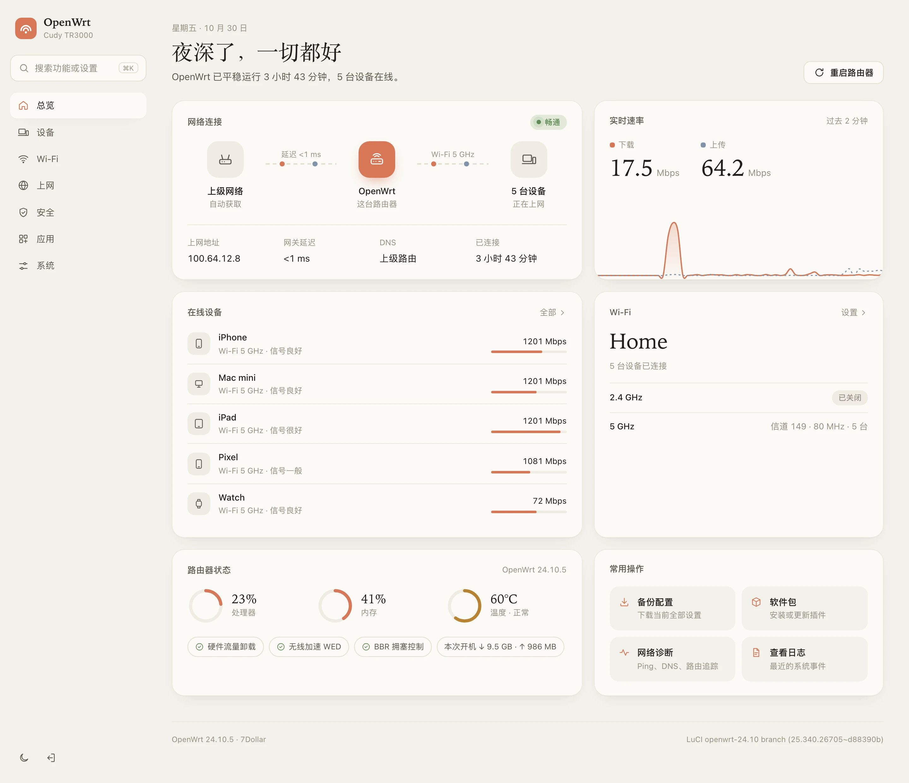
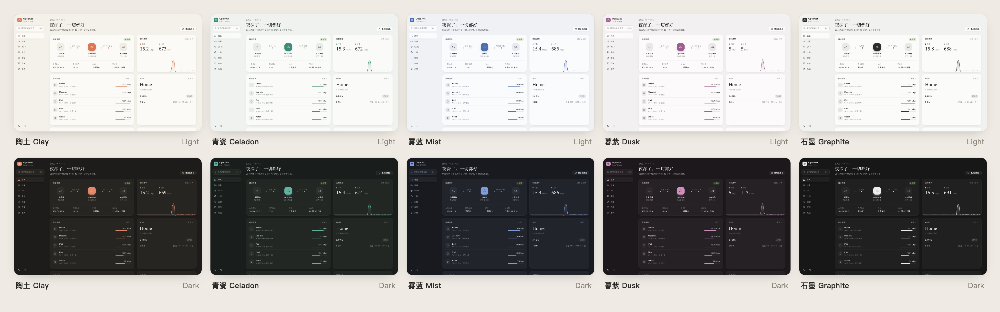
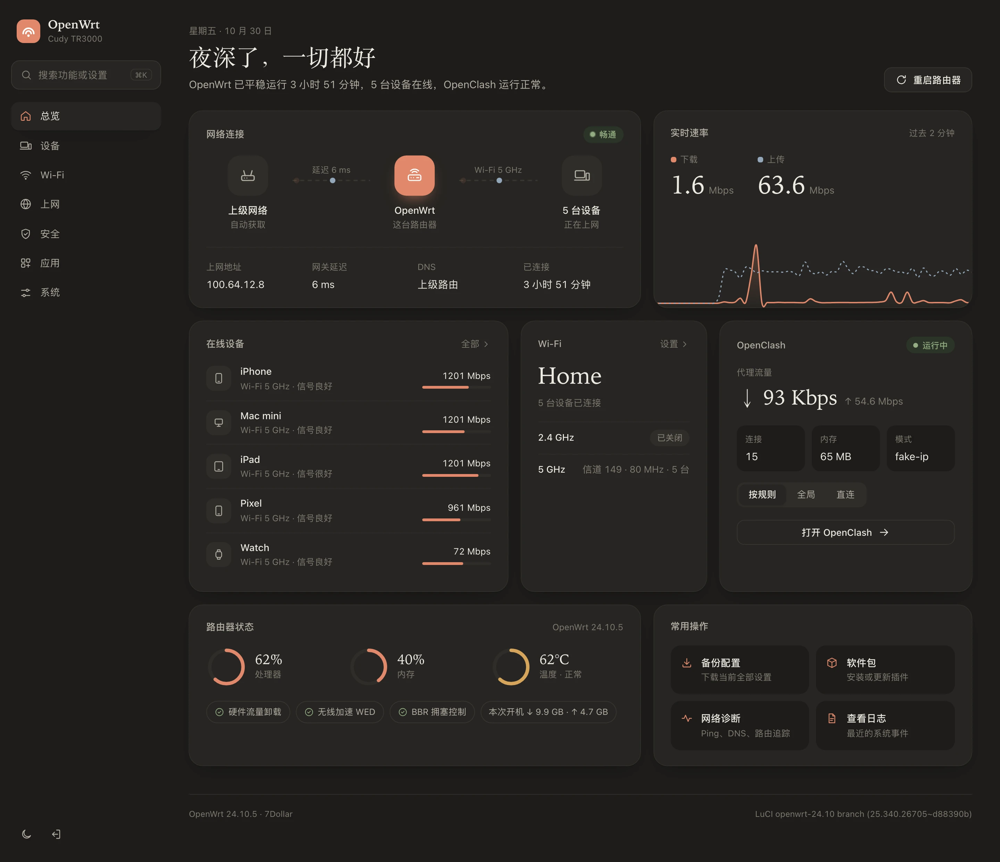
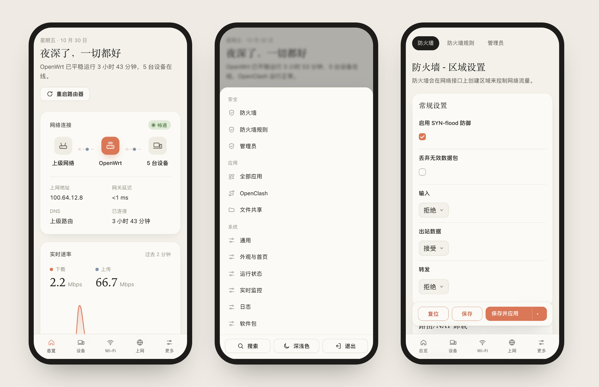
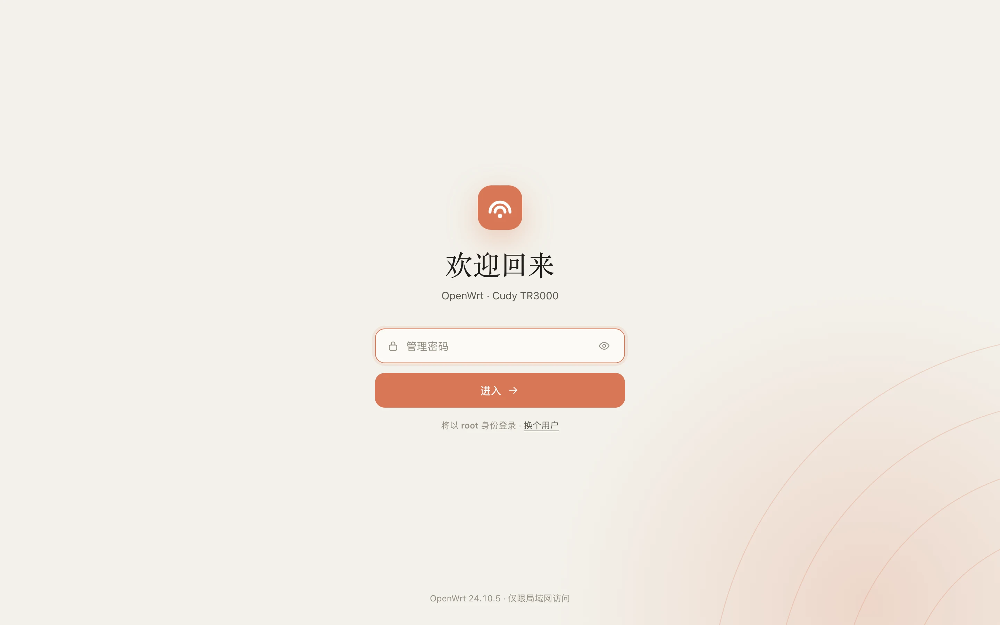
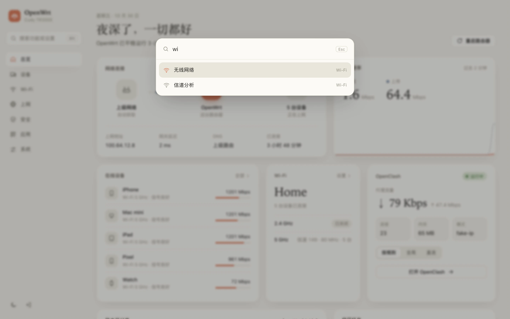
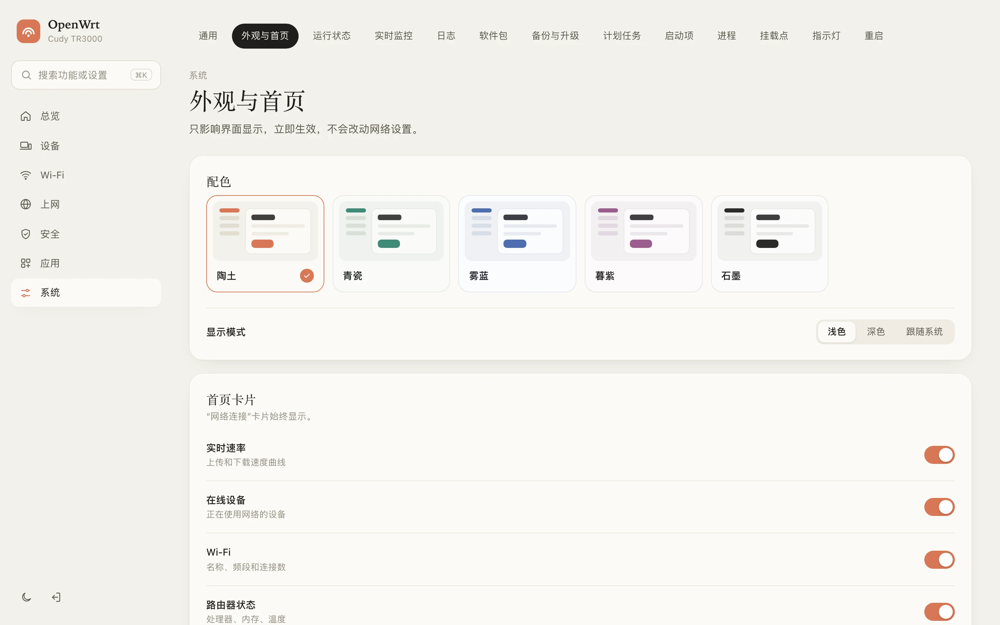
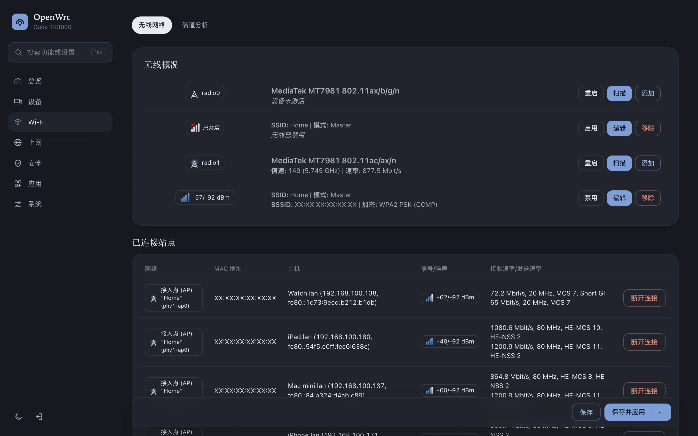

<p align="center">
  
</p>

<h1 align="center">7Dollar</h1>

<p align="center">
  简洁、轻量的 OpenWrt LuCI 主题<br>
  <sub>A clean, lightweight theme for OpenWrt LuCI</sub>
</p>

<p align="center">
  
  
  
</p>

<p align="center">
  <a href="#安装">安装</a> · <a href="#使用">使用</a> · <a href="#卸载">卸载</a> · <a href="#english">English</a>
</p>

<p align="center">
  
</p>

## 关于名字

开发这个主题一共花了 **7 美元** 的 AI Token 费用，所以叫 7Dollar。

## 特性

- **首页总览**：网络状态、延迟、实时速率、在线设备、Wi‑Fi、系统负载
- **按用途分组的菜单**：总览 / 设备 / Wi‑Fi / 上网 / 安全 / 应用 / 系统，支持 <kbd>⌘K</kbd> / <kbd>Ctrl K</kbd> 搜索
- **5 套配色**：陶土、青瓷、雾蓝、暮紫、石墨，各有浅色 / 深色，可跟随系统
- **插件卡片可选**：默认不显示任何代理信息；装了 OpenClash 可在设置中开启
- **自适应**：手机、平板、页面缩放下都会重新排版
- **轻量**：无外部字体和请求，CSS 15 KB（gzip），安装包 44 KB
- **兼容原生页面**：LuCI 所有功能保持不变

## 截图

<p align="center"></p>

<table>
  <tr>
    <td width="50%"><p align="center"><sub>深色模式 · OpenClash 卡片</sub></p></td>
    <td width="50%"><p align="center"><sub>手机</sub></p></td>
  </tr>
  <tr>
    <td width="50%"><p align="center"><sub>登录页</sub></p></td>
    <td width="50%"><p align="center"><sub>搜索</sub></p></td>
  </tr>
  <tr>
    <td width="50%"><p align="center"><sub>外观设置</sub></p></td>
    <td width="50%"><p align="center"><sub>原生页面</sub></p></td>
  </tr>
</table>

## 安装

先确认路由器系统是 **OpenWrt 23.05 或更新版本**（后台「状态 → 概览」里能看到版本号）。

### 方法一：网页上传（推荐，不用命令行）

1. 下载安装包：[luci-theme-7dollar_1.0.0-r1_all.ipk](https://github.com/itsmaiGe/luci-theme-7dollar/raw/main/dist/luci-theme-7dollar_1.0.0-r1_all.ipk)
2. 浏览器打开路由器后台（通常是 `192.168.1.1`），输入密码登录
3. 点 **系统 → 软件包 → 上传软件包…**，选择刚下载的文件，点 **上传**，再点 **安装**
4. 刷新页面（Windows 按 <kbd>F5</kbd>，Mac 按 <kbd>⌘ R</kbd>）

> 刷新后没变化：打开 **系统 → 系统 → 语言和界面**，把 **主题** 改成 **7Dollar**，点 **保存并应用**。

### 方法二：一行命令

适用于 23.05 及以上，包括使用 `apk` 的 OpenWrt 25.x。

1. 打开终端：Mac 搜索「终端」，Windows 搜索「PowerShell」
2. 登录路由器（把 IP 换成你的路由器地址）：

   ```sh
   ssh root@192.168.1.1
   ```

   首次连接提示 `yes/no` 时输入 `yes` 回车；然后输入路由器密码回车（输入时不显示字符，属于正常现象）。

3. 粘贴下面这行并回车，看到「完成」后刷新浏览器：

   ```sh
   wget -qO- https://raw.githubusercontent.com/itsmaiGe/luci-theme-7dollar/main/install.sh | sh
   ```

<details>
<summary><b>下载失败</b></summary>

<br>

国内访问 GitHub 不稳定时，建议用方法一：先在电脑上下载安装包再上传。

或者使用 GitHub 加速代理（替换 `<代理地址>`）：

```sh
wget -qO- <代理地址>/https://raw.githubusercontent.com/itsmaiGe/luci-theme-7dollar/main/install.sh | PROXY=<代理地址>/ sh
```
</details>

<details>
<summary><b>从源码编译</b></summary>

<br>

在 OpenWrt 源码或 SDK 中：

```sh
git clone https://github.com/itsmaiGe/luci-theme-7dollar.git feeds/luci/themes/luci-theme-7dollar
./scripts/feeds update -i && ./scripts/feeds install luci-theme-7dollar
make menuconfig   # LuCI → Themes → luci-theme-7dollar
make package/luci-theme-7dollar/compile V=s
```

不使用 SDK 时，可在 macOS / Linux 上运行 `./scripts/build-ipk.sh`，输出到 `dist/`。
</details>

## 使用

| 操作 | 位置 |
| --- | --- |
| 切换配色 / 深浅色 | 系统 → 外观与首页（左下角 🌙 可快速切换深浅色） |
| 调整首页卡片 | 系统 → 外观与首页 → 首页卡片 |
| 显示 OpenClash 卡片 | 系统 → 外观与首页 → 插件卡片 |
| 查看在线设备 | 侧边栏「设备」 |
| 搜索设置 | <kbd>⌘K</kbd> / <kbd>Ctrl K</kbd> / <kbd>/</kbd> |
| 打开已装插件 | 侧边栏「应用」 |

设置保存在 `/etc/config/7dollar`，仅影响界面显示，不会修改网络配置。

## 卸载

- **换回其他主题**：系统 → 系统 → 语言和界面 → 主题，选择 Bootstrap 或其他主题，保存并应用
- **彻底卸载**：系统 → 软件包 → 已安装，搜索 `7dollar`，点 **移除**（会自动切回 Bootstrap）
- **命令卸载**：

  ```sh
  wget -qO- https://raw.githubusercontent.com/itsmaiGe/luci-theme-7dollar/main/uninstall.sh | sh
  ```

<details>
<summary><b>后台无法打开时</b></summary>

<br>

SSH 登录路由器后执行，立即切回默认主题：

```sh
uci set luci.main.mediaurlbase=/luci-static/bootstrap && uci commit luci
```
</details>

## 兼容性

| | |
| --- | --- |
| OpenWrt | 23.05、24.10（ucode LuCI）；25.x 请使用方法二；不支持 22.03 及更早版本 |
| 浏览器 | 近两年的 Chrome、Edge、Safari、Firefox 及手机浏览器 |
| 已测试 | Cudy TR3000 · OpenWrt 24.10.5 · MT7981B |
| 共存 | 可与 Bootstrap、Argon 等主题同时安装 |

## 目录结构

```
htdocs/luci-static/7dollar/      样式、图标、Logo
htdocs/luci-static/resources/    导航与页面脚本
ucode/template/themes/7dollar/   页面框架、登录页
root/                            默认配置、菜单、权限
dist/                            ipk 安装包
install.sh / uninstall.sh        安装 / 卸载脚本
```

## 致谢

- [OpenWrt LuCI](https://github.com/openwrt/luci)
- [zashboard](https://github.com/Zephyruso/zashboard)：多配色设计参考
- 默认配色参考 Claude 的橙色

## English

**7Dollar** is a clean, card-based LuCI theme for OpenWrt 23.05+ (ucode LuCI). The name comes from its cost: **$7** in AI tokens.

- Home dashboard with connection status, live throughput, devices, Wi‑Fi and system health
- Menus grouped by purpose, with <kbd>⌘K</kbd> search
- 5 palettes (Clay, Celadon, Mist, Dusk, Graphite), each in light and dark
- Optional plugin cards. OpenClash is off by default.
- Responsive and zoom-friendly; no external fonts or requests; 44 KB package

**Install**: upload [the ipk](https://github.com/itsmaiGe/luci-theme-7dollar/raw/main/dist/luci-theme-7dollar_1.0.0-r1_all.ipk) via *System → Software → Upload Package*, or run over SSH:

```sh
wget -qO- https://raw.githubusercontent.com/itsmaiGe/luci-theme-7dollar/main/install.sh | sh
```

**Uninstall**: `opkg remove luci-theme-7dollar` or the `uninstall.sh` one-liner.

## License

[Apache-2.0](LICENSE) © itsmaiGe
